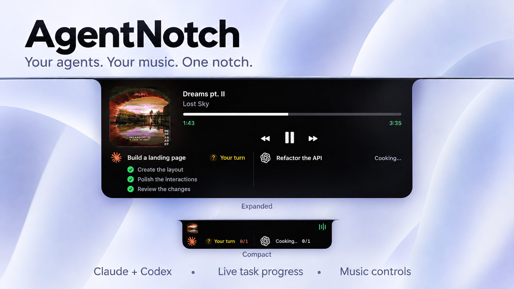

<h1 align="center">AgentNotch</h1>
<p align="center"><strong>Your agents. Your music. One notch.</strong></p>
<p align="center">A native macOS notch companion for Claude and Codex.</p>
<p align="center">macOS 14+ · Swift & SwiftUI · Apple Silicon & Intel · GPL-3.0</p>



*Marketing illustration based on the app. Chat and task names are examples.*

AgentNotch brings local AI chat activity, task progress, and music controls to the top of your screen. Expand the notch to see what your agents are doing, open a chat’s tasks, or control playback.

## Features

- **Live agent activity** — separate Claude and Codex session lists, with working, waiting-for-you, and completed states.
- **Inline tasks** — click a chat to expand its tasks in place; click again to collapse. Double-click to open the chat in its app.
- **Quiet animations** — sequential cooking dots, a gold “Your turn” invitation, and completion feedback. Respects Reduce Motion.
- **Stable layout** — existing chats keep their order; scrolling starts when a list has more than three chats.
- **Music controls** — album artwork, playback timeline, previous/next, and play/pause.
- **More notch tools** — calendar, file shelf, camera preview, and system indicators.
- **Experimental webcam recognition** — local face enrollment and matching. This is not Apple’s TrueDepth Face ID.

## Build and run

Requires macOS 14 or later and full Xcode. The local build was verified with Xcode 27.1. Command Line Tools alone are insufficient.

1. Clone this repository and open `AgentNotch.xcodeproj`.
2. Select the **AgentNotch** scheme and **My Mac**.
3. Build and run from Xcode.

For an ad-hoc local Release package:

```sh
./scripts/build-local.sh
```

Outputs: `dist/AgentNotch.app` and `dist/AgentNotch.zip`. These are local build outputs, not notarized release downloads. Automatic updates are currently disabled.

## How it works

Open the notch to inspect agent sessions alongside your music. Click a chat title to show or hide its tasks; double-click to open that conversation. Lists with up to three chats stay still. Longer lists can be scrolled.

Claude and Codex activity comes from local app metadata and session transcripts through an XPC helper. Provider storage formats and deep links can change, so detection is best effort. AgentNotch does not send prompts to an AI provider or execute chat tasks.

## Privacy and permissions

Agent activity is read locally, including session titles and task metadata. Codex unread-state matching reads account identifiers from a local token payload; AgentNotch does not transmit that token. Do not publish session files, account files, or screenshots containing private chats.

Camera access supports preview and optional face enrollment. Calendar access supports calendar features. Face templates are stored in the local Keychain. Webcam recognition is experimental and should not be treated as a security boundary.

## Checks

```sh
./scripts/test-agent-sessions.sh
./scripts/test-face-recognition.sh
```

The face test suite does not open the camera or access Keychain by default.

## Contributing

Focused pull requests and bug reports are welcome. See [CONTRIBUTING.md](CONTRIBUTING.md) and [SECURITY.md](SECURITY.md).

## Credits and license

Developed and branded as **AgentNotch**. See [Attribution](docs/ATTRIBUTION.md) for source provenance and original contributor credits.

Distributed under [GPL-3.0](LICENSE). Dependency and model notices are in [THIRD_PARTY_LICENSES](THIRD_PARTY_LICENSES) and [FaceRecognition-LICENSE.txt](AgentNotch/Resources/FaceRecognition-LICENSE.txt). Product names and marks belong to their respective owners. AgentNotch is an independent project.
